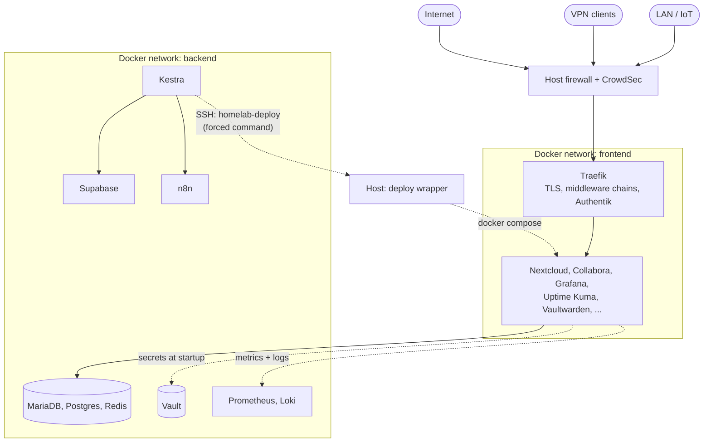

# Homelab infrastructure as code

The configuration of my self-hosted homelab: about 30 Docker services on a small mini PC,
defined in Git, with secrets in HashiCorp Vault, layered edge security, and an update pipeline
that asks me before it changes anything.

This repository is a curated, sanitized export of my private Gitea repository. It is not a
one-click installer. Each folder is a working stack you can read, copy and adapt.

## At a glance

- **Scale:** about 30 services in 39 containers on one mini PC, all defined in Git
- **Secrets:** HashiCorp Vault, one AppRole per service, secrets fetched at container start
- **Updates:** detected automatically, deployed only after I approve them
- **Security:** least-privilege containers, layered edge security, 14 alert rules as code
- **Recovery:** full rebuild tested in an isolated VM, about one hour from empty VM to running services
- **Operations:** a weekly automated audit turns every finding into a tracked issue

I designed, built and run the platform myself, with Claude Code as pair programmer
([details below](#built-with-ai-assistance)).

## Highlights

| | |
|---|---|
| **[Update pipeline](update-pipeline/)** | Kestra detects new image versions, n8n summarizes the changelog with Claude, I approve in my task app, and a Git commit plus a webhook deploys it. Supabase is the source of truth for target versions. Guard rails keep critical services manual. |
| **[Secrets in Vault](secrets-vault/)** | Migrated from SOPS-encrypted `.env` files to HashiCorp Vault while the services kept running. One AppRole per service, and two injection patterns depending on what the image ships (entrypoint vs. sidecar). |
| **[Edge security](edge-security/)** | Traefik middleware chains per exposure level (internal / trusted / public), Authentik SSO, CrowdSec at HTTP and firewall level with a custom scenario and a cloud-network blocklist approved in Telegram, and a host firewall that rolls itself back if I lock myself out. |
| **[Container hardening](container-hardening/)** | Every container drops all capabilities and gets back only what its image provably needs, with `no-new-privileges`, memory and PID limits and health checks. A check script fails on any unjustified gap, daemon defaults cover ad-hoc containers, and a weekly Trivy scan reports fixable CVEs. |
| **[Detection](detection/)** | Security alerts as code: SSH logins, failed sudo, account and critical-file changes (auditd), AppArmor denials, OOM kills and deploys outside the pipeline go from the journal through Loki to Grafana and Telegram. One provisioned rule per file, each with its rationale and a tested trigger. |
| **[Disaster recovery](disaster-recovery/)** | Ansible rebuilds the host layer (disks, Docker, firewall, CrowdSec, mail, auditd), then the services come back from Borg and a Vault snapshot through the same deploy path as every day. Tested end to end in an isolated VM behind an allowlist proxy: about one hour from an empty VM to 36 healthy containers. |
| **[Weekly system checks](system-checks/)** | Every Friday a script audits the host (containers, backups, disks, certificates, Trivy, Lynis, open ports, apt, Ansible drift). Scripts decide what is a finding; Claude Haiku only writes the explanation from redacted findings. Each finding becomes one deduplicated Gitea issue and a task, and is followed up until it is fixed. |

## Results

- **Service secrets are not in compose files, `.env` files or Git.** They come from Vault at
  container start. The few deliberate exceptions are listed in [secrets-vault](secrets-vault/#deliberate-exceptions).
- **No update without approval.** New versions are detected, summarized and staged
  automatically, but they are deployed only after I approve them. Critical services stay manual.
- **Restore is measured, not assumed:** about 55-60 minutes from an empty VM to 36 running
  containers. Building and running the test found ten problems that would have hit a real recovery.
- **Least privilege is checked, not just intended:** the check script reports 39 containers with
  0 unjustified capability or limit gaps.
- **Problems surface on their own:** security events reach Telegram through 14 provisioned alert
  rules, each with a tested trigger, and the weekly audit opens one deduplicated issue per finding.
- **Nightly Nextcloud backup down from about 4 hours to about 25 minutes** after fixing how
  archives were named (see below).

## Engineering challenges

Real problems from running this setup. Each one is written up in the folder it belongs to.

| Problem | Root cause | Fix |
|---|---|---|
| The Nextcloud backup re-read all 760 GB every night (about 4 hours) and never pruned old archives. | In Borg 2, the files cache and `prune` work per archive name. Timestamped names made every run a new series. | One fixed archive name. The next measured run took about 25 minutes. [backup](backup/#nextcloud-with-borg-nextcloud-borg) |
| After an automatic reboot, Vault and Traefik stayed off for about four hours, although both use `restart: unless-stopped`. | Log rotation reloaded them with `docker kill --signal`, which Docker records as a manual stop. The seal check failed silently when Vault was gone. | Signal the host PID instead, and report "unreachable" as its own status. [secrets-vault](secrets-vault/#postmortem-vault-stayed-off-after-a-reboot) |
| Kestra was down for hours after a nightly backup. | All containers restarted at once. Kestra came up before Postgres and its JVM hung instead of exiting, so Docker never restarted it. | Stop the databases last and start them first, wait for them to be healthy, and make Kestra wait for Postgres. [backup](backup/#docker-data-stop-and-start-in-order) |
| The Uptime Kuma status page rendered blank. | The status page and the dashboard are the same single-page app, and the page needs the shared JS bundle and API paths from the root. | A path-split Traefik router: status page plus shared paths on a less restricted chain, everything else on trusted networks + Authentik. [observability](observability/#details-worth-copying) |

## Architecture

## Technology stack

| Area | Tools |
|---|---|
| Platform | Debian, Docker, Docker Compose, Ansible |
| Edge and access | Traefik, Authentik (SSO), CrowdSec (incl. AppSec WAF), nftables |
| Secrets | HashiCorp Vault (AppRole, vault-agent), SOPS (legacy) |
| Security checks | Trivy, Lynis, auditd, AppArmor, gitleaks |
| Observability | Prometheus, Grafana, Loki, Alloy, cAdvisor, Uptime Kuma |
| Automation | Kestra, n8n, Supabase, Claude API, Telegram bot |
| Data | PostgreSQL, MariaDB, Redis, Borg, Duplicati |
| Applications | Nextcloud, Collabora Online, Gitea, AdGuard Home |
| Languages | Bash, Python, YAML, SQL |

## Repository layout

| Folder | Content |
|---|---|
| [`update-pipeline/`](update-pipeline/) | Kestra flows, Supabase schema and scripts, n8n workflow, deploy scripts |
| [`secrets-vault/`](secrets-vault/) | Vault setup, both secret-injection patterns, unseal and seal-alert scripts |
| [`edge-security/`](edge-security/) | Traefik static and dynamic config, Authentik, CrowdSec, host firewall and hardening |
| [`container-hardening/`](container-hardening/) | Hardening baseline, ADR, check script and matrix, Docker daemon config, Trivy scan |
| [`detection/`](detection/) | Grafana alert rules as code, auditd watch list, alert test runbook, ADR |
| [`disaster-recovery/`](disaster-recovery/) | Ansible playbooks and roles for the host, restore playbook, isolated VM test, runbook, ADR |
| [`system-checks/`](system-checks/) | Weekly host audit, issue sync, n8n workflow for the Claude review, allowlists, ADR |
| [`observability/`](observability/) | Prometheus, Grafana, Loki, Alloy, cAdvisor, Uptime Kuma |
| [`cloud/`](cloud/) | Nextcloud and Collabora Online |
| [`backup/`](backup/) | Borg backup for Nextcloud, Duplicati |
| [`network/`](network/) | AdGuard Home |
| [`development/`](development/) | Gitea (Git server, trigger of the update pipeline) |

Every folder has its own README that explains the design decisions and the pitfalls I ran into.

## Conventions used throughout

- **One compose file per service**, versions via `${VERSION}`. In my setup, `VERSION` comes from
  a central `versions.yaml` (see the update pipeline).
- **External Docker networks** `frontend` (everything Traefik routes to) and `backend`
  (databases, Vault, internal APIs). Create them once:
  `docker network create frontend && docker network create backend`.
- **Traefik labels reference shared middleware chains** (`...-chain@file`) from
  `edge-security/traefik/dynamic/` instead of defining access rules per service.
- **Secrets are never in compose files or `.env` files.** Containers log in to Vault with an
  AppRole whose credentials are Docker secrets, included via `/opt/docker/secrets/secrets.yaml`.
  `*.env.example` files contain only non-secret settings.
- **Placeholders:** `example.com` for domains, RFC 5737 ranges (`192.0.2.0/24`,
  `198.51.100.0/24`, `203.0.113.0/24`) for my LAN, IoT and VPN networks, and `<...>` for keys.

## How this export is made

The export is generated by a script in my private repository. It copies an explicit allowlist of
files, replaces domains, internal IPs and keys, and then refuses to publish if any real secret
value (collected from my decrypted configuration), private domain, internal IP or e-mail
address is still present, or if `gitleaks` finds anything.

## Built with AI assistance

I used [Claude Code](https://claude.com/claude-code) as an AI pair programmer for much of the
implementation, debugging and documentation. I made the architecture decisions, and I
reviewed, tested and operate everything on my own hardware.

## License

[MIT](LICENSE)
