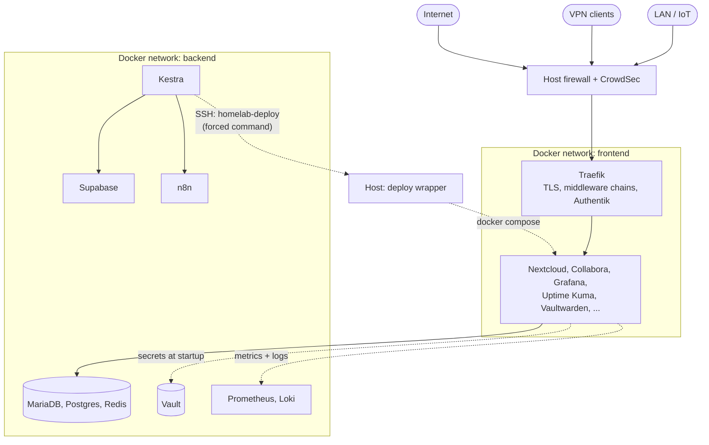

# Homelab infrastructure as code

The configuration of my self-hosted homelab: about 30 Docker services on a small mini PC,
defined in Git, with secrets in HashiCorp Vault, layered edge security, and an update pipeline
that asks me before it changes anything.

This repository is a curated, sanitized export of my private Gitea repository. It is not a
one-click installer. Each folder is a working stack you can read, copy and adapt.

## Highlights

| | |
|---|---|
| **[Update pipeline](update-pipeline/)** | Kestra detects new image versions, n8n summarizes the changelog with Claude, I approve in my task app, and a Git commit plus a webhook deploys it. Supabase is the source of truth for target versions. Guard rails keep critical services manual. |
| **[Secrets in Vault](secrets-vault/)** | Migrated from SOPS-encrypted `.env` files to HashiCorp Vault while the services kept running. One AppRole per service, and two injection patterns depending on what the image ships (entrypoint vs. sidecar). |
| **[Edge security](edge-security/)** | Traefik middleware chains per exposure level (internal / trusted / public), Authentik SSO, CrowdSec at HTTP and firewall level with a custom scenario and a cloud-network blocklist approved in Telegram, and a host firewall that rolls itself back if I lock myself out. |
| **[Container hardening](container-hardening/)** | Every container drops all capabilities and gets back only what its image provably needs, with `no-new-privileges`, memory and PID limits and health checks. A check script fails on any unjustified gap, daemon defaults cover ad-hoc containers, and a weekly Trivy scan reports fixable CVEs. |
| **[Detection](detection/)** | Security alerts as code: SSH logins, failed sudo, account and critical-file changes (auditd), AppArmor denials, OOM kills and deploys outside the pipeline go from the journal through Loki to Grafana and Telegram. One provisioned rule per file, each with its rationale and a tested trigger. |

## Architecture

## Repository layout

| Folder | Content |
|---|---|
| [`update-pipeline/`](update-pipeline/) | Kestra flows, Supabase schema and scripts, n8n workflow, deploy scripts |
| [`secrets-vault/`](secrets-vault/) | Vault setup, both secret-injection patterns, unseal and seal-alert scripts |
| [`edge-security/`](edge-security/) | Traefik static and dynamic config, Authentik, CrowdSec, host firewall and hardening |
| [`container-hardening/`](container-hardening/) | Hardening baseline, ADR, check script and matrix, Docker daemon config, Trivy scan |
| [`detection/`](detection/) | Grafana alert rules as code, auditd watch list, alert test runbook, ADR |
| [`observability/`](observability/) | Prometheus, Grafana, Loki, Alloy, cAdvisor, Uptime Kuma |
| [`cloud/`](cloud/) | Nextcloud and Collabora Online |
| [`backup/`](backup/) | Borg backup for Nextcloud, Duplicati |
| [`network/`](network/) | AdGuard Home |
| [`development/`](development/) | Gitea (Git server, trigger of the update pipeline) |

Every folder has its own README that explains the design decisions and the pitfalls I ran into.

## Conventions used throughout

- **One compose file per service**, versions via `${VERSION}`. In my setup, `VERSION` comes from
  a central `versions.yaml` (see the update pipeline).
- **External Docker networks** `frontend` (everything Traefik routes to) and `backend`
  (databases, Vault, internal APIs). Create them once:
  `docker network create frontend && docker network create backend`.
- **Traefik labels reference shared middleware chains** (`...-chain@file`) from
  `edge-security/traefik/dynamic/` instead of defining access rules per service.
- **Secrets are never in compose files or `.env` files.** Containers log in to Vault with an
  AppRole whose credentials are Docker secrets, included via `/opt/docker/secrets/secrets.yaml`.
  `*.env.example` files contain only non-secret settings.
- **Placeholders:** `example.com` for domains, RFC 5737 ranges (`192.0.2.0/24`,
  `198.51.100.0/24`, `203.0.113.0/24`) for my LAN, IoT and VPN networks, and `<...>` for keys.

## How this export is made

The export is generated by a script in my private repository. It copies an explicit allowlist of
files, replaces domains, internal IPs and keys, and then refuses to publish if any real secret
value (collected from my decrypted configuration), private domain, internal IP or e-mail
address is still present, or if `gitleaks` finds anything.

## Built with AI assistance

I used [Claude Code](https://claude.com/claude-code) as an AI pair programmer for much of the
implementation, debugging and documentation. I made the architecture decisions, and I
reviewed, tested and operate everything on my own hardware.

## License

[MIT](LICENSE)
