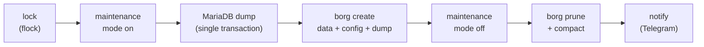

# Backup

Scripted, consistent backups where a file copy would not be enough (Nextcloud with Borg, the
Postgres instances, Vault in `secrets-vault/`), and Duplicati to take everything off-site.

## Nextcloud with Borg (`nextcloud-borg/`)

`backup_nextcloud_borg.sh` produces a consistent snapshot of files, config and database:

- **Maintenance mode for the whole run, on purpose:** files and database dump always match.
  Only the first full run is long (about 760 GB, mostly photos and videos). Later runs only
  read new and changed files thanks to Borg's files cache, so the downtime shrinks to minutes.
  Compression is `auto,zstd,3`: on that first run `lzma,6` saved only about 7 % and made the
  run CPU-bound. `auto` stores incompressible media uncompressed.
- **One fixed archive name, no timestamp:** in Borg 2, archives with the same name form a
  series, and both the files cache and `prune` work per series. My first version named every
  archive `nextcloud-<timestamp>`, so every run was a new series: the files cache never hit
  (every run re-chunked all 760 GB, about 4 hours) and `prune` never deleted anything. Borg
  stores the timestamp itself, and the archive ID is unique anyway.
- **Always leaves maintenance mode:** an EXIT trap turns maintenance mode off and cleans up the
  dump, even if a step in between fails.
- **No password on the command line:** the database root password stays inside the MariaDB
  container. The container's shell reads it from the Vault-provided file and passes it to
  `mariadb-dump` via `MYSQL_PWD`, so it never shows up in `ps`.
- **Failures are not swallowed:** the dump is piped to `gzip` on the host under
  `set -o pipefail`, then checked for size and gzip integrity before Borg runs.
- **Encrypted repository** (`repokey-aes-ocb`), initialized automatically on the first run.
- **Repository passphrase from Vault**, fetched before maintenance mode is switched on, so a
  sealed Vault fails the run without downtime. The script runs on the host, where Vault has no
  published port, so it uses the Vault CLI inside the Vault container. Its own AppRole
  (read-only on exactly one path) logs in with `role_id`/`secret_id` passed as JSON on stdin,
  never as arguments. An empty token aborts the run: otherwise the CLI would quietly fall back
  to a token file left over from an interactive admin login.
- **Telegram notification** on success and failure, sent from the EXIT trap so a crash is
  reported too. The bot token never appears on a command line, and a failed notification never
  fails the backup.
- Every log line also goes to the systemd journal (`logger -t backup-nextcloud`), which Alloy
  ships to Loki (see `observability/`), so backup results show up in Grafana. Tailing the log
  file directly would not work reliably: it is reset at the start of each run and trimmed by
  replacing it.

## Postgres (`postgres/`)

`backup_postgres.sh` dumps both Postgres instances every night: the Supabase database (update
pipeline, CrowdSec history) and the shared instance for Authentik, Gitea and Kestra. A daily
Kestra flow runs it on the host through the deploy wrapper and reports the result in Telegram.

- **`pg_dumpall`, not a copy of the data directory:** copying the files of a running Postgres
  does not give a consistent state, a dump does. It also contains the roles and every database
  of the instance.
- **Checked before it counts:** the exit status of the whole pipe, `gzip -t`, and the closing
  line that `pg_dumpall` only writes after a complete run. Only then is the temporary file
  renamed. A broken dump leaves nothing behind that looks like a backup.
- **One instance failing does not stop the other.** The report lists both, and the run fails if
  either did.
- Passwords stay inside the containers, files and directory are readable by root only.
  Retention is 14 days plus the Sunday dumps of 8 weeks, as for the Vault snapshots.

## Duplicati (`duplicati/`)

Web-UI-based, encrypted, deduplicated backups of the remaining data.

- The web UI password and the key that encrypts Duplicati's own database (backup passphrases,
  destination credentials) come from Vault (AppRole entrypoint, see `secrets-vault/`). The
  container refuses to start without the key rather than storing these secrets in plain text.
- Reachable from trusted networks only (`only-trusted`). There is deliberately **no Authentik** in front of it:
  Duplicati's new web UI handles its own login tokens, and the forward-auth layer raced with
  them, which caused intermittent authentication failures. The VPN plus Duplicati's own password
  turned out to be the stable combination.

Hostnames and IP ranges are placeholders (`example.com`, RFC 5737 ranges).
