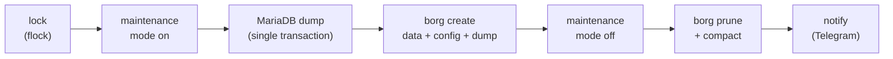

# Backup

Two complementary tools: a scripted, consistent backup of Nextcloud with Borg, and Duplicati
for everything else.

## Nextcloud with Borg (`nextcloud-borg/`)

`backup_nextcloud_borg.sh` produces a consistent snapshot of files, config and database:

- **Maintenance mode for the whole run, on purpose:** files and database dump always match.
  Only the first full run is long (about 760 GB, mostly photos and videos). Later runs only
  read new and changed files thanks to Borg's files cache, so the downtime shrinks to minutes.
  Compression is `auto,zstd,3`: on that first run `lzma,6` saved only about 7 % and made the
  run CPU-bound. `auto` stores incompressible media uncompressed.
- **One fixed archive name, no timestamp:** in Borg 2, archives with the same name form a
  series, and both the files cache and `prune` work per series. My first version named every
  archive `nextcloud-<timestamp>`, so every run was a new series: the files cache never hit
  (every run re-chunked all 760 GB, about 4 hours) and `prune` never deleted anything. Borg
  stores the timestamp itself, and the archive ID is unique anyway.
- **Always leaves maintenance mode:** an EXIT trap turns maintenance mode off and cleans up the
  dump, even if a step in between fails.
- **No password on the command line:** the database root password stays inside the MariaDB
  container. The container's shell reads it from the Vault-provided file and passes it to
  `mariadb-dump` via `MYSQL_PWD`, so it never shows up in `ps`.
- **Failures are not swallowed:** the dump is piped to `gzip` on the host under
  `set -o pipefail`, then checked for size and gzip integrity before Borg runs.
- **Encrypted repository** (`repokey-aes-ocb`), initialized automatically on the first run.
- **Repository passphrase from Vault**, fetched before maintenance mode is switched on, so a
  sealed Vault fails the run without downtime. The script runs on the host, where Vault has no
  published port, so it uses the Vault CLI inside the Vault container. Its own AppRole
  (read-only on exactly one path) logs in with `role_id`/`secret_id` passed as JSON on stdin,
  never as arguments. An empty token aborts the run: otherwise the CLI would quietly fall back
  to a token file left over from an interactive admin login.
- **Telegram notification** on success and failure, sent from the EXIT trap so a crash is
  reported too. The bot token never appears on a command line, and a failed notification never
  fails the backup.
- Log files are shipped to Loki by Alloy (see `observability/`), so backup results show up in
  Grafana.

## Duplicati (`duplicati/`)

Web-UI-based, encrypted, deduplicated backups of the remaining data.

- The web UI password comes from Vault (AppRole entrypoint, see `secrets-vault/`).
- Reachable from trusted networks only (`only-trusted`). There is deliberately **no Authentik** in front of it:
  Duplicati's new web UI handles its own login tokens, and the forward-auth layer raced with
  them, which caused intermittent authentication failures. The VPN plus Duplicati's own password
  turned out to be the stable combination.

Hostnames and IP ranges are placeholders (`example.com`, RFC 5737 ranges).
