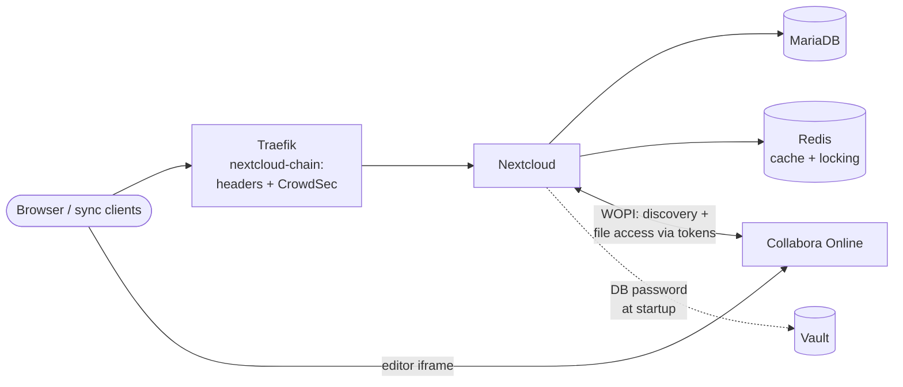

# Cloud: Nextcloud + Collabora

Self-hosted file sync, calendar/contacts and online office, replacing the usual cloud
services.

## Nextcloud (`nextcloud/`)

- The entrypoint logs in to Vault with an AppRole, reads the database password, exports it and
  then starts the original Nextcloud entrypoint. The image has `curl` but no `jq`, so the JSON
  is parsed with `grep`/`cut`. The password never touches the host's disk.
- Reverse-proxy settings (`OVERWRITEHOST`, `OVERWRITEPROTOCOL`, trusted domains) are set in
  the compose file. The `.well-known` redirects for CalDAV/CardDAV, WebFinger and NodeInfo are
  Traefik labels.
- Hard memory limit via `mem_limit`. `deploy.resources` is silently ignored outside Swarm,
  which I only noticed through `docker stats`.
- Publicly reachable, protected by security headers and CrowdSec. Nextcloud has its own login
  and brute-force throttling, so there is no Authentik in front of it.

## Collabora (`collabora/`)

A dedicated Collabora Online container instead of the built-in CODE app (`richdocumentscode`),
which runs inside the Nextcloud container:

- Own subdomain. The browser loads the editor directly from Collabora, inside an iframe in
  Nextcloud. Authentication uses WOPI tokens, so there is no Authentik here either.
- `aliasgroup1` allows only my own Nextcloud to use the server.
- TLS ends at Traefik (`ssl.termination=true`).
- `no-new-privileges` is deliberately **not** set: Collabora's jail isolation needs file
  capabilities, which that option would disable.
- **Gotcha:** Nextcloud's WOPI allowlist must contain the **Docker gateway IPs**. That is where
  Collabora's callbacks appear to come from. Neither the hostname nor the frontend subnet works.

## Backup

See `backup/nextcloud-borg/`: maintenance mode, database dump, Borg archive with prune and
compact, Telegram notification.

Hostnames and IP ranges are placeholders (`example.com`, RFC 5737 ranges).
