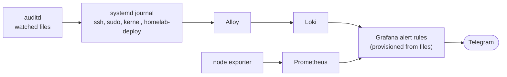

# Detection: security alerts as code

Hardening ([container-hardening](../container-hardening/)) limits what an attacker can do.
This part makes sure I notice when something unusual happens on the host: systemd journal,
kernel and audit events and host metrics feed a small set of Grafana alert rules that send a
Telegram message.



## Rules

| Rule | Detects | Why it matters |
|---|---|---|
| SSH login | every SSH login, with user and source IP | Remote access is the main way in. Kestra's own logins as `deploy` from its fixed address are excluded, `deploy` from anywhere else still fires. |
| Failed sudo | wrong password, user not in sudoers | Rare in normal use, typical when someone tries to escalate. |
| Users or groups changed | `useradd`, `usermod`, `passwd`, ... | Creating an account is a classic persistence step. |
| AppArmor denial | blocked action, with process and profile | All containers run with `cap_drop: ALL` and `no-new-privileges`; a denial means a process tried to do more than its job. |
| OOM kill | killed process | A container hit its memory limit, or something on the host eats memory. |
| Critical file changed | write or attribute change on sudoers, sshd config, `authorized_keys`, the deploy wrapper, Docker's `daemon.json`, cron, systemd units | These files decide who gets in and what runs at boot. |
| Deploy wrapper outside Kestra | `homelab-deploy` calls that do not come from Kestra, were rejected, or targeted an excluded service | The only path from automation to Docker ([ADR 002](../container-hardening/002-docker-socket-access.md)); anything else is manual or suspicious. |
| Vault: failed AppRole logins | more than 2 in 5 minutes, with source IP | Someone guessing credentials, or a leaked role ID used from the wrong place (roles are CIDR-bound). |
| Vault: root token used | any request with a root-policy token, with path | Root is for setup and break-glass only. |
| Vault: secret changed | create/update/delete under `homelab/`, with actor | No service writes secrets; every change is manual and should be expected. |
| Low disk space | under 10 % free for 10 minutes | A full SSD would also stop Vault through its audit file. |
| Unexpected reboot | boot time changed | A reboot I did not plan. |
| Sustained CPU > 90 % / unusual outbound traffic | 15 minutes above the threshold | Crypto miner, data exfiltration. |

Example message:

```
🚨 SSH-Login – ausgelöst
🔓 SSH-Login: alice von 192.0.2.10
Details: sudo journalctl -u ssh -n 20 auf dem Host
Zeit: 27.10.2026 19:09
```

## How it is built

- **One file per rule** (`grafana-alerting/`, Grafana provisioning format), mounted read-only
  into Grafana. Each file starts with a comment on what it detects and why. Changes go through
  Git; the UI only shows them.
- **The contact point is code too** (`grafana-alerting/00-contact-point.yaml`): Telegram with
  the message template, bot token and chat ID as `$TELEGRAM_*` placeholders that Grafana fills
  from environment variables, which its entrypoint reads from Vault at startup. No secret in
  the repository, and rotating the token means one Vault update plus a restart.
- **Messages name the facts.** Queries extract fields with `regexp` and group by them, so the
  message says *who*, *from where* or *which process*, plus the command to look at details.
- **auditd** (`auditd/`) watches a short list of files and tags every record with one key;
  the journal carries the records to Loki.
- **Every rule is tested** with a harmless trigger after each change:
  [runbook](alert-tests.md).

Decision record with the alternatives (Wazuh, Falco, CrowdSec only, Loki ruler):
[ADR 003](003-detection-as-code.md).

Pitfalls I ran into:
- Loki alert queries must be metric queries (`count_over_time`), a plain log query fails
  with "input data must be a wide series".
- The kernel logs container OOM kills as "Memory cgroup **out of memory**" (lower case).
- Provisioning files interpolate `$VARIABLES`, so templates use `{{ .Labels.x }}` instead of
  `$labels`; `.Values` only contains reduce/math expressions, not the raw query.
- In Alloy, `stage.labels` maps label names to *extracted fields*; a literal value there
  silently produces an empty label.

## Files

| Path | Content |
|---|---|
| `grafana-alerting/` | contact point (`00-`) and one alert rule per file |
| `auditd/` | audit watch list and installer |
| `alert-tests.md` | test runbook: one harmless trigger per rule |
| `003-detection-as-code.md` | ADR |

The log pipeline (Alloy, Loki, Prometheus, Grafana) is in [observability](../observability/).
