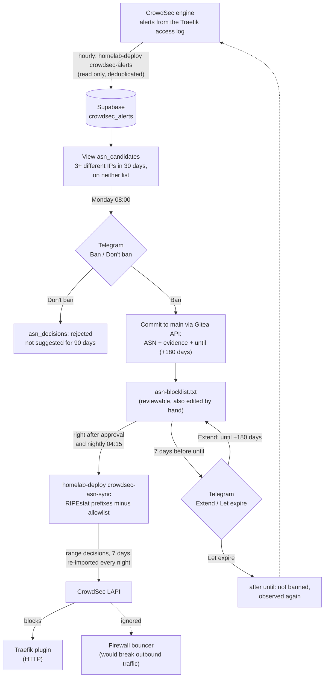

# Edge security: Traefik, Authentik, CrowdSec, host firewall

Defense in depth for everything that is reachable over HTTP. A request has to pass several
independent layers, and each layer can fail without the next one depending on it.

## Traefik

- **Static config** (`traefik/traefik.yaml`): entrypoints `web`/`websecure`, a separate
  `metrics` entrypoint for Prometheus, the Docker provider with `exposedByDefault: false` (it
  reads the Docker API through a read-only socket proxy, not a socket mount), and
  the file provider for the middlewares. Certificates come from Let's Encrypt via a DNS
  challenge, so no port has to be open for the ACME check.
- **Trusted proxies:** `X-Forwarded-For` is only accepted from the VPN range and the Docker
  networks, so a client cannot fake its source IP to get past an allowlist.
- **JSON access log**, read by CrowdSec.

## Middleware chains: one chain per exposure level

Each service picks one chain (`traefik/dynamic/middleware-chain.yaml`) instead of composing
middlewares in its own labels. Exposure decisions live in one file and are easy to review.

| Building block | Purpose |
|---|---|
| `only-internal` | LAN + IoT + VPN + Docker networks |
| `only-trusted` | trusted networks: the VPN, the host itself and the Docker networks for container-to-container calls through Traefik (admin UIs: Vault, Duplicati, Prometheus UI) |
| `only-iot` | IoT network (sensor endpoints) |
| `authentik` | forward auth / SSO in front of apps without their own login |
| `secure-headers` | HSTS, no sniffing, frame protection (relaxed only where needed, e.g. Collabora inside Nextcloud's iframe) |
| `*-ratelimit` | per service, tuned to its traffic pattern |
| `crowdsec` | Traefik bouncer plugin, blocks known-bad IPs before the app sees the request |

Examples: `std-adm-internal-chain` = trusted networks + Authentik, `vaultwarden-public-chain` = headers +
rate limit + CrowdSec (public, the app has its own strong auth), `vault-chain` = trusted networks only.

## Authentik

Self-hosted SSO (`authentik/`). Traefik's forward-auth middleware sends unauthenticated users to
the Authentik outpost. Grafana also uses Authentik as an OAuth provider. Server and worker fetch
their secrets from Vault at startup with Python's `urllib`, because the image ships neither
curl nor wget. Both run as the image's unprivileged user without any Linux capabilities, and the worker
has no Docker socket: only the embedded outpost is used, so it needs no Docker integration.

## CrowdSec

- **Two bouncers:** the Traefik plugin works at HTTP level. The firewall bouncer also inserts its
  blocklist into iptables `DOCKER-USER`, so published Docker ports are covered too. They bypass
  the host's INPUT chain.
- **Custom scenario** `crowdsec/homelab-http-401-bf.yaml`: the stock `http-generic-bf` only
  counts 401 responses to POST requests, which misses basic auth and token APIs (GET). This
  scenario counts every 401 (10 attempts, leak rate 1 per 10 s) and excludes Nextcloud's
  WebDAV/OCS sync, whose clients produce 401 series by design.
- **ASN blocklist** for cloud networks that scan from a new IP every time, see below.
- **Escalating bans** for repeat offenders, the Authentik log parser, and Telegram notifications
  (`crowdsec/crowdsec-telegram.sh`, which asks for the credentials interactively so nothing
  ends up in the repository).

### ASN blocklist: suggest, approve, expire (ADR 005)

In 30 days, 52 of 69 CrowdSec alerts came from two cloud networks, nearly every time from a
fresh IP. A per-IP ban always came one scan too late. Banning whole networks fixes that, but
a wrong network ban blocks real users. So the threshold only **suggests** a network. The
decision is one tap in Telegram, and every ban expires.

- **The list is the source of truth.** `crowdsec/asn-blocklist.txt` is a file in the repository.
  Each line names its evidence and an expiry date. Telegram approval only adds a commit, so every
  ban can be traced in git history. Removing a line lifts the ban on the next run.
- **Re-applied every night instead of "permanent".** CrowdSec decisions always expire, and its
  database flush removes old ones. The nightly run deletes the old range decisions and imports
  the current set with a 7-day duration. It fetches all prefixes first, so if a lookup fails,
  the existing bans stay untouched. If the flow stops, the bans run out within a week instead of
  staying forever.
- **HTTP only.** The decisions carry the reason `homelab/asn-blocklist`, and the firewall bouncer
  ignores it (`scenarios_not_containing`). That bouncer matches source IPs, so it would also drop
  the replies to the homelab's own connections to these clouds: image pulls, APIs and webhooks.
  The sync refuses to import while that filter is missing. After every run it checks that a
  sample address is banned in the LAPI and absent from the firewall's ipsets.
- **Guard rails.**
  - An allowlist takes precedence: own ISP, Telegram, the VPN used for tests.
  - An ASN on both lists stops the run.
  - The sync also stops on implausibly large prefixes, more than 20,000 prefixes in total, or a
    line without an expiry date.
  - Only button clicks from the own chat count, and approval checks the allowlist again.
  - The webhook key between the listener and the decision flow comes from Vault.
- **Why expiry after 180 days.** A banned network produces almost no alerts, so a ban cannot
  prove itself. Letting it expire and observing again can: if the network keeps scanning, it is
  suggested again within 30 days.

Code: Kestra flows `crowdsec-alerts-import`, `crowdsec-asn-sync`, `crowdsec-asn-candidates`,
`crowdsec-asn-decision` (in `crowdsec/`). Host scripts `crowdsec-asn-blocklist.sh`,
`crowdsec-asn-prefixes.py` and `crowdsec-alerts-export.py` run through the deploy wrapper.
The Supabase side is in `update-pipeline/supabase/`: `record-crowdsec-alerts.py`,
`report-asn-candidates.py`, `asn-decision.py`, `asn-expiry-notify.py` and migrations 008-010.

## Host

- `host/host-firewall.nft`: an nftables table for services that listen on the host itself. It
  deliberately reloads only its own table (no `flush ruleset`), so Docker's and CrowdSec's
  rules stay untouched.
- Containers may only reach what they need on the host: the CrowdSec LAPI for Traefik's
  bouncer, SSH for the deploy wrapper (from Kestra's fixed address only), and 80/443. The last
  one is needed because a container in Traefik's own network that calls a public hostname goes
  through `docker-proxy` on the host, not through the port DNAT. Nextcloud and Collabora broke
  when I first left it out; the firewall's drop log showed why.
- `host/sshd-homelab.conf`: keys only, no direct root login, `AllowUsers` limited to the admin
  and to the deploy user from Kestra's address.
- `host/host-firewall.sh apply` loads the rules **on trial with an automatic rollback after
  3 minutes**. `confirm` (from a second SSH session) makes them permanent. A typo cannot lock
  me out.
- `host/apply-host-hardening.sh`: idempotent host-side hardening with a timestamped backup and
  printed rollback commands. It covers dashboard API protection, trusted-proxy cleanup, CrowdSec
  acquisition and profiles, and a YAML syntax check before anything is reloaded.

## Files

| Path | Content |
|---|---|
| `traefik/` | compose file, static config, `dynamic/` middlewares and chains |
| `authentik/` | Authentik server + worker (secrets from Vault) |
| `crowdsec/` | custom 401 scenario, Telegram notification setup, ASN block-/allowlist, sync and alert export scripts, the four ASN flows |
| `host/` | nftables ruleset, trial-apply script, hardening script |

Hostnames and IP ranges are placeholders (`example.com`, RFC 5737 ranges).
