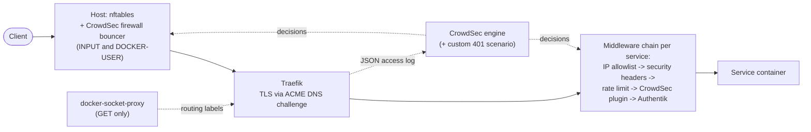

# Edge security: Traefik, Authentik, CrowdSec, host firewall

Defense in depth for everything that is reachable over HTTP. A request has to pass several
independent layers, and each layer can fail without the next one depending on it.

## Traefik

- **Static config** (`traefik/traefik.yaml`): entrypoints `web`/`websecure`, a separate
  `metrics` entrypoint for Prometheus, the Docker provider with `exposedByDefault: false` (it
  reads the Docker API through a read-only socket proxy, not a socket mount), and
  the file provider for the middlewares. Certificates come from Let's Encrypt via a DNS
  challenge, so no port has to be open for the ACME check.
- **Trusted proxies:** `X-Forwarded-For` is only accepted from the VPN range and the Docker
  networks, so a client cannot fake its source IP to get past an allowlist.
- **JSON access log**, read by CrowdSec.

## Middleware chains: one chain per exposure level

Each service picks one chain (`traefik/dynamic/middleware-chain.yaml`) instead of composing
middlewares in its own labels. Exposure decisions live in one file and are easy to review.

| Building block | Purpose |
|---|---|
| `only-internal` | LAN + IoT + VPN + Docker networks |
| `only-trusted` | trusted networks: the VPN, the host itself and the Docker networks for container-to-container calls through Traefik (admin UIs: Vault, Duplicati, Prometheus UI) |
| `only-iot` | IoT network (sensor endpoints) |
| `authentik` | forward auth / SSO in front of apps without their own login |
| `secure-headers` | HSTS, no sniffing, frame protection (relaxed only where needed, e.g. Collabora inside Nextcloud's iframe) |
| `*-ratelimit` | per service, tuned to its traffic pattern |
| `crowdsec` | Traefik bouncer plugin, blocks known-bad IPs before the app sees the request |

Examples: `std-adm-internal-chain` = trusted networks + Authentik, `vaultwarden-public-chain` = headers +
rate limit + CrowdSec (public, the app has its own strong auth), `vault-chain` = trusted networks only.

## Authentik

Self-hosted SSO (`authentik/`). Traefik's forward-auth middleware sends unauthenticated users to
the Authentik outpost. Grafana also uses Authentik as an OAuth provider. Server and worker fetch
their secrets from Vault at startup with Python's `urllib`, because the image ships neither
curl nor wget. Both run as the image's unprivileged user without any Linux capabilities, and the worker
has no Docker socket: only the embedded outpost is used, so it needs no Docker integration.

## CrowdSec

- **Two bouncers:** the Traefik plugin works at HTTP level. The firewall bouncer also inserts its
  blocklist into iptables `DOCKER-USER`, so published Docker ports are covered too. They bypass
  the host's INPUT chain.
- **Custom scenario** `crowdsec/homelab-http-401-bf.yaml`: the stock `http-generic-bf` only
  counts 401 responses to POST requests, which misses basic auth and token APIs (GET). This
  scenario counts every 401 (10 attempts, leak rate 1 per 10 s) and excludes Nextcloud's
  WebDAV/OCS sync, whose clients produce 401 series by design.
- **Escalating bans** for repeat offenders, the Authentik log parser, and Telegram notifications
  (`crowdsec/crowdsec-telegram.sh`, which asks for the credentials interactively so nothing
  ends up in the repository).

## Host

- `host/host-firewall.nft`: an nftables table for services that listen on the host itself. It
  deliberately reloads only its own table (no `flush ruleset`), so Docker's and CrowdSec's
  rules stay untouched.
- `host/host-firewall.sh apply` loads the rules **on trial with an automatic rollback after
  3 minutes**. `confirm` (from a second SSH session) makes them permanent. A typo cannot lock
  me out.
- `host/apply-host-hardening.sh`: idempotent host-side hardening with a timestamped backup and
  printed rollback commands. It covers dashboard API protection, trusted-proxy cleanup, CrowdSec
  acquisition and profiles, and a YAML syntax check before anything is reloaded.

## Files

| Path | Content |
|---|---|
| `traefik/` | compose file, static config, `dynamic/` middlewares and chains |
| `authentik/` | Authentik server + worker (secrets from Vault) |
| `crowdsec/` | custom 401 scenario, Telegram notification setup |
| `host/` | nftables ruleset, trial-apply script, hardening script |

Hostnames and IP ranges are placeholders (`example.com`, RFC 5737 ranges).
