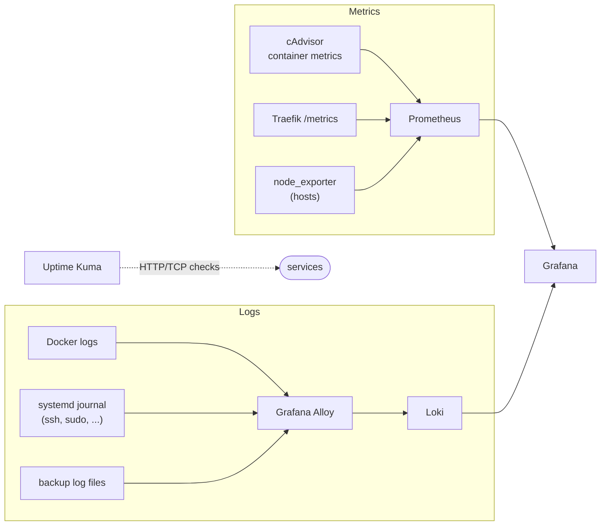

# Observability: metrics, logs, uptime

Each stack here is a self-contained compose file plus an example config you can copy.

## Stacks

| Stack | What it does | Access |
|---|---|---|
| **Prometheus** (`prometheus/`) | Scrapes cAdvisor, Traefik and node exporters | API for Grafana: internal networks + basic auth. UI: trusted networks + Authentik |
| **Grafana** (`grafana/`) | Dashboards for Prometheus and Loki. Datasources are provisioned from a file, admin password from Vault | Internal networks, "Sign in with Authentik" via OAuth |
| **Loki** (`loki/`) | Log storage on the filesystem, 7-day retention | Internal networks + basic auth for pushes from other hosts |
| **Alloy** (`alloy/`) | Collects Docker container logs (with container labels), the systemd journal and the backup scripts' log files, then pushes them to Loki | UI: trusted networks + Authentik |
| **cAdvisor** (`cadvisor/`) | Per-container CPU, memory and network metrics | Internal networks |
| **Uptime Kuma** (`uptime-kuma/`) | Availability checks plus a status page | Dashboard: trusted networks + Authentik. Status page: internal networks, no login |

## Details worth copying

- **Backup logs in Loki:** Alloy tails the log files written by the backup scripts
  (`backup/nextcloud-borg/`) and labels them per job, so a failed backup shows up in Grafana
  next to the container logs.
- **The systemd journal is the important source.** SSH logins and sudo usage only exist there,
  not in any container log.
- **Uptime Kuma behind a path-split router:** the status page and the dashboard are the same
  single-page app. The status page needs the shared JS bundle and API paths from the root, so
  Traefik routes `/status/*` *plus* those shared paths to a less restricted chain, and
  everything else to trusted networks + Authentik. The obvious "route only `/status`" rule renders a blank
  page.
- **Prometheus reaches Traefik's metrics over the internal Docker network** (`traefik:8082`)
  instead of a published host port.

## Setup

1. Copy the stack folder and rename `*.env.example` to `<name>.env`. Set `TRAEFIK_HOST` and
   `VERSION`.
2. Copy `*.yaml.example` configs to the paths mounted in the compose file and adjust the
   targets.
3. The middleware chains referenced in the labels (`std-app-internal-chain@file` etc.) are
   defined in `edge-security/traefik/dynamic/`.
4. Services that fetch secrets from Vault (Grafana) need an AppRole, see `secrets-vault/`.

Hostnames and IP ranges are placeholders (`example.com`, RFC 5737 ranges).
