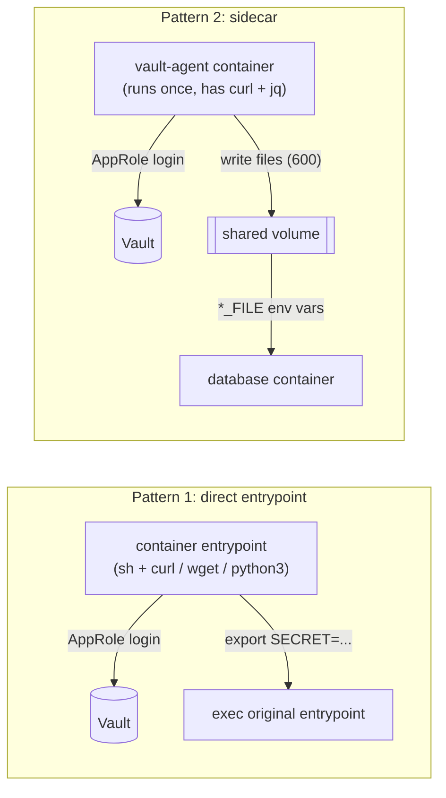

# Secrets: from SOPS to HashiCorp Vault

All service secrets used to live in SOPS-encrypted `.env` files and were decrypted at deploy
time. I migrated the homelab to **HashiCorp Vault**, one service at a time and without
downtime. Now every container fetches its secrets from Vault when it starts and never writes
them to disk on the host. SOPS remains only for non-secret settings such as hostnames, plus
one documented exception (see below).

**Want to try it?** [HOWTO.md](HOWTO.md) walks through putting one service behind Vault, from
storing the secret to the compose file, with Vaultwarden as the example.

## Building blocks

- **One AppRole per service** with a read-only policy on exactly the paths that service needs:

  ```hcl
  # policy "nextcloud-ro"
  path "homelab/data/databases/mariadb" { capabilities = ["read"] }
  path "homelab/data/databases/redis"   { capabilities = ["read"] }
  ```

- **Bootstrap credentials** (`role_id` / `secret_id`) are Docker secrets: root-only files on the
  host, included by every compose file via `include: /opt/docker/secrets/secrets.yaml` and
  mounted at `/run/secrets/<service>_vault_role_id`.
- **KV v2** under the mount `homelab/`: `homelab/services/<name>` and `homelab/databases/<name>`.
  Several consumers of the same database (Authentik, Gitea, Kestra, n8n on Postgres) read their
  own keys from one shared path.

## Two patterns, chosen by what the image ships



**1. Direct entrypoint** (`examples/direct-entrypoint-vaultwarden/`)
The compose file overrides the entrypoint with a short shell script: log in with the AppRole,
read the secret, `export` it, then `exec` the image's original entrypoint. The secret only
exists in the process environment. The HTTP client depends on the image:

| Image ships | Used by |
|---|---|
| `curl` + `grep`/`cut` (no `jq`) | Vaultwarden, Nextcloud, Kestra, Duplicati, Grafana |
| `wget` only | n8n |
| `python3` only (`urllib`) | Authentik (no curl, no wget) |

**2. Sidecar** (`examples/sidecar-mariadb/`, `examples/sidecar-postgres/`)
Official database images have neither curl nor wget, and the entrypoint must not be replaced.
A small helper container logs in, writes the secrets as files (mode 600) into a named volume
and exits. The database waits for it via `depends_on: condition: service_completed_successfully`
and reads the values through the image's native `*_PASSWORD_FILE` variables. The Supabase stack
uses the same pattern for all of its services.

## Operating Vault

- **Storage:** integrated Raft storage, single node (`vault/vault.hcl`). TLS ends at Traefik,
  and the UI is reachable from trusted networks only.
- **Unsealing stays manual** (3 of 5 key shares, kept in a password manager).
  `scripts/vault-unseal.fish` asks for the keys with hidden input and re-checks the seal status
  after each key. Nothing is stored or logged.
- **Seal monitoring:** `scripts/check_vault_sealed.sh` runs from cron and sends a Telegram
  message on every status change. Its own Telegram credentials are deliberately **not** in
  Vault: an alert that needs Vault to send "Vault is sealed" would never fire.
- **Never auto-updated:** a Vault restart means a sealed Vault, which means every service that
  fetches a secret at startup fails. The update pipeline excludes Vault for that reason.

## Deliberate exceptions

- **Loki basic auth** stays in SOPS. Traefik reads basic-auth users from labels when the
  container is created, and three different approaches to pass them in from Vault each broke
  something else. I documented the decision instead of forcing it.
- **Redis** currently runs without a password (internal backend network only). Moving it to
  Vault is open work.

## Files

| Path | Content |
|---|---|
| `HOWTO.md` | step-by-step: put a new service behind Vault |
| `secrets.yaml.example` | template for the shared Docker-secrets file |
| `vault/` | Vault compose file and `vault.hcl` |
| `examples/direct-entrypoint-vaultwarden/` | pattern 1 |
| `examples/sidecar-mariadb/`, `examples/sidecar-postgres/` | pattern 2 |
| `scripts/vault-unseal.fish` | interactive unseal helper |
| `scripts/check_vault_sealed.sh` | cron-based seal alert via Telegram |

More services that use these patterns: `update-pipeline/kestra` (feeds Kestra's `secret()`),
`edge-security/authentik` (python3), `cloud/nextcloud`, `observability/grafana`,
`backup/duplicati`. A host script variant (no container of its own) is the Borg backup in
`backup/nextcloud-borg`: it fetches the repository passphrase through the Vault CLI inside the
Vault container.
