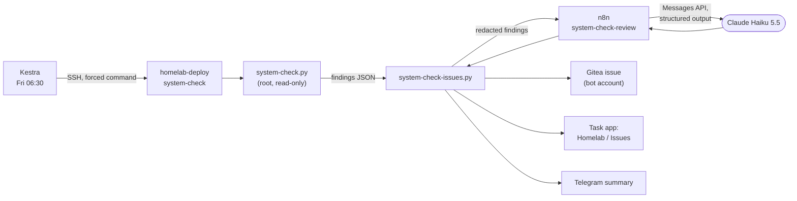

# Weekly system checks

Live alerts catch events (an SSH login, a full disk, a sealed Vault). They do not catch slow
drift: a log source that stopped shipping, a port that should not be open, a certificate that
will not renew, a Lynis warning nobody looks at, a host that no longer matches its Ansible roles.
Two recent incidents went unnoticed for exactly this reason: Kestra hung for hours after a
nightly backup restart, and backup logs were missing in Loki for two weeks.

So every Friday morning a script audits the host, Claude writes the explanation, and every
finding becomes a Gitea issue plus a task in my task app. The decision is recorded in
[ADR 007](007-weekly-system-checks-claude-review.md).

## Scripts decide, Claude explains

The most important rule: **a script decides what is a finding**, with fixed thresholds.
Claude only writes the text (what is going on, likely cause, next steps) and the Telegram
summary. It cannot add, drop or re-rate a finding; its answer is filtered to the fingerprints
that were sent. That keeps the check reproducible and cheap: weeks without findings make no API
call, and a run with findings costs a fraction of a cent.

| Area | Check | Finding when |
|---|---|---|
| Containers | state | unhealthy, restart loop, exited (except one-shot sidecars with exit 0) |
| | Docker socket proxy | still on the live Docker socket? It bind-mounts the socket file, so a recreated socket leaves it on a dead inode – compared host vs. container |
| Backups | log files on the host | no successful run in 26 h, or any error in the last 8 days |
| | Duplicati (off-site) | no successful run in 26 h, failures this week, or no reports at all (state from the [`duplicati-report`](../backup/duplicati/duplicati-report.yml) webhook) |
| Disks | usage, mounts | from 85 % (critical from 95 %), data disk not mounted |
| Security | Trivy | fixable CRITICAL in a running image (one aggregated finding) |
| | Lynis | warnings not in [`lynis-baseline.txt`](config/lynis-baseline.txt) |
| | ports | listening ports not in [`expected-ports.txt`](config/expected-ports.txt) |
| | expiry dates | tokens and similar from a small TSV file, 21 days ahead |
| Certificates | Traefik `acme.json` | expires in less than 21 days |
| Updates | apt | security updates pending and unattended-upgrades idle for 26 h; reboot pending > 3 days |
| | image candidates | update candidates waiting for approval for more than 14 days |
| Drift | host checkout | not on `main`, behind, or with local changes |
| | Ansible | [`drift-check.yml`](../disaster-recovery/ansible/drift-check.yml) in check mode reports changes |
| | push mirror | last error set or no sync for 26 h |

Each check runs isolated: if one crashes, the others still run and the crash itself becomes a
finding.

## Redaction before anything leaves the homelab

Only the findings go to the API, never raw logs, and only after redaction right before the call:
domains, internal IPs, user names, mail addresses, credentials in URLs, `key=value` secrets, long
token-like strings and digests become placeholders such as `<internal-ip>` or `<redacted>`. The
Gitea issues keep the full details, because they never leave the homelab.

If n8n, the API or the JSON validation fails, the issue is written from a fixed template. A
finding is never lost because the review step is down.

## One issue per problem, not per run

Every finding has a stable **fingerprint** (check + subject), stored as a hidden HTML comment in
the issue body. On each run:

| State | Gitea | Task app |
|---|---|---|
| new | issue with labels `auto` + area | task with a link to the issue |
| still open | reminder comment, at most every 6 days | unchanged |
| reappeared after "resolved" | comment right away | unchanged |
| gone | one comment "no longer seen since …"; closing stays manual | unchanged |
| closed by hand | – | task set to done on the next run |

## Details worth copying

- **A bot account with a narrow token.** Issues are opened by a dedicated Gitea user. As a
  collaborator it could push code, so its token only has `write:issue` and `read:repository`.
  Testing that `GET /user` returns 403 proves the *scope*, not the *owner*: my first token was
  created while logged in as myself, so the issues showed my name. Check whose token it is.
- **Own comments are recognised by a marker, not by author.** After switching the token, the
  reminder logic no longer recognised the old comments. A hidden `<!-- syscheck -->` marker in
  every bot comment does not depend on who wrote it.
- **Structured outputs instead of "please answer in JSON".** The n8n workflow sends a JSON schema
  in `output_config.format`, effort `low`. Haiku 5.5 thinks by default, so the answer starts with
  a thinking block: read the block with `type == "text"`, not `content[0]`.
- **Baselines before going live.** Lynis and the port check open an issue for everything not on
  their allowlist. The first run produced 17 findings; each was either fixed (xrdp masked,
  Postfix banner without OS name) or added to the baseline with a reason. The flow ran with
  `DRY_RUN` (Telegram only, no issues) until that was done.
- **Aggregate noisy sources.** Trivy listed 15 images with fixable CVEs as 15 issues. Most need
  a rebuild by the image maintainer and arrive through the update pipeline anyway, so it is now
  one finding listing all images.
- **Ephemeral UDP ports are client sockets.** DNS lookups and QUIC show up as listening UDP
  ports in the ephemeral range; ignoring that range removed all port-check noise.
- **The Ansible drift check runs on the host itself** (`-c local`) without the role that needs
  the ansible-vault password, so that password never touches the host. The firewall role's
  lock-out guard (it checks `SSH_CLIENT`) is skipped on local connections.

## Files

| Path | Content |
|---|---|
| [`system-check.py`](scripts/system-check.py) | all host checks, runs as root via the deploy wrapper, writes findings as JSON |
| [`system-check-issues.py`](scripts/system-check-issues.py) | deduplication, Gitea issues and comments, task app, redaction, review call, Telegram text |
| [`system-checks.yml`](kestra/system-checks.yml) | Kestra flow (schedule, SSH call, issue sync, Telegram) |
| [`system-check-review.json`](n8n/system-check-review.json) | n8n workflow: webhook secret check, Claude request with JSON schema, answer validation |
| [`config/`](config/) | port and Lynis allowlists |
| [`007-weekly-system-checks-claude-review.md`](007-weekly-system-checks-claude-review.md) | ADR |

The deploy wrapper with the `system-check` action is in
[`update-pipeline/deploy/`](../update-pipeline/deploy/), the Trivy scan that writes the state file
in [`container-hardening/trivy/`](../container-hardening/trivy/). Issue texts and Telegram
messages are in German.
