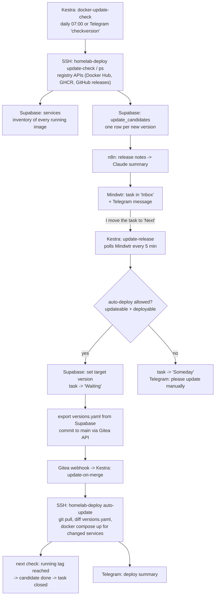
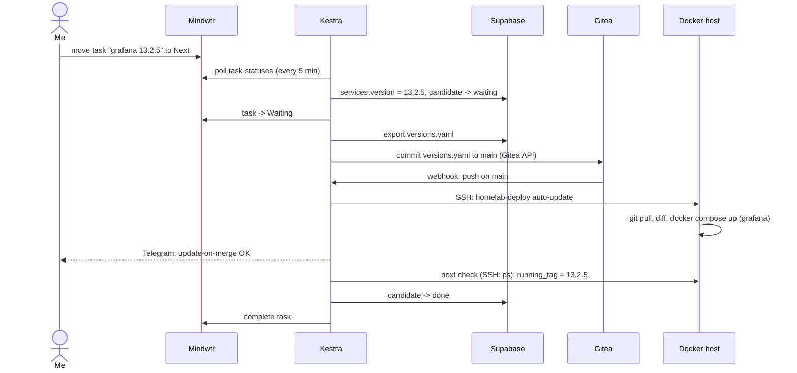

# Update pipeline

Container updates with a human in the loop: the homelab finds new image versions on its own,
summarizes the changelog with an LLM, and asks me for approval in my task app. When I approve,
the change is committed to Git and deployed by a webhook. No container updates itself silently,
and Kestra has no access to the Docker socket: everything that touches Docker runs through one
forced-command wrapper on the host.

| Component | Role |
|---|---|
| **Kestra** | Orchestrator: daily check, 5-minute release poll, deploy on merge |
| **Supabase** (Postgres + PostgREST) | Source of truth for target versions, inventory and update candidates |
| **n8n** | Fetches GitHub release notes and summarizes them with Claude |
| **Mindwtr** (self-hosted task app) | Approval UI: one task per update, the task status is the decision |
| **Gitea** | Holds `versions.yaml`; a push to `main` triggers the deploy |
| **Telegram** | Notifications and the on-demand command `checkversion` |

## How an update flows through the system

### Step by step

1. **Detect** (`kestra/flows/docker-update-check.yml`, `kestra/scripts/docker-update-check.sh`)
   Kestra calls `homelab-deploy update-check` and `ps` on the host (it has no Docker access
   itself); the host lists running images and asks Docker Hub and GHCR for newer tags.
   The search pattern is derived from the current tag, so `11.4` only matches `11.x`, which
   keeps the major version pinned. Date-based tags such as `2026.09.07-sha-7996410` (Supabase
   Studio) are compared by date. Components that are not images, such as a Traefik plugin
   pinned via `git checkout`, are checked against GitHub releases (`manual-plugin-versions.yaml`).
   The raw result goes to Telegram right away. That part has no dependency on Supabase, n8n or
   Mindwtr, so it keeps working when they are down.

2. **Record** (`supabase/scripts/record-inventory.py`, `record-candidates.py`)
   Every running image is upserted into `services` (actual state: `running_tag`, `last_seen`).
   Each new version becomes a row in `update_candidates`. A database trigger only accepts
   candidates whose image matches a known service.

3. **Summarize and ask** (`supabase/scripts/process-candidate.py pending`, `n8n/changelog-summary.json`)
   For every open candidate without a task, n8n maps the image to its GitHub repo, fetches the
   release notes and has Claude summarize them, including breaking changes and a
   recommendation. The script then creates a Mindwtr task in the project's "Updates" section
   and sends a Telegram message. A newer version of the same service updates the existing task
   instead of creating a second one.

4. **Approve** (`kestra/flows/update-release.yml`, `process-candidate.py release`)
   The task status is the decision. Every five minutes Kestra reads the task statuses:

   | Mindwtr status | Meaning |
   |---|---|
   | Inbox | new, not decided yet |
   | **Next** | **approved**: set the target version in Supabase |
   | Waiting | approved and handed to the deploy, or a stack update that is not possible yet |
   | Someday | approved, but needs a manual deploy (Telegram tells me why) |
   | Done / Archived | checked off; the candidates are closed |

5. **Commit** (`supabase/scripts/export-versions.py`, `commit-versions.py`)
   `versions.yaml` is generated from Supabase and committed to `main` through the **Gitea API**
   (contents endpoint with the file's previous `sha`, so a concurrent change is rejected instead
   of overwritten). No git and no SSH key in Kestra. Committing to the remote instead of the
   server checkout matters: the deploy step below detects changes by diffing before and after
   its own pull.

6. **Deploy** (`kestra/flows/update-on-merge.yml`, `deploy/homelab-deploy`)
   The push fires a Gitea webhook. Kestra has **no Docker socket**: it calls
   `homelab-deploy auto-update` on the host over SSH, as a user that is not in the `docker`
   group, with a forced command and a key that only works from Kestra's address. The wrapper
   pulls as the checkout owner, diffs `versions.yaml` before and after, and redeploys only the
   services whose version changed (a changed `*.env.sops` too). Vault, Authentik, Traefik and
   Kestra itself are never deployed this way. The SOPS age key is fetched from Vault for the
   duration of the call only. Every call is logged to the journal.

7. **Close the loop**
   The next check sees the new `running_tag`. A trigger marks the candidate `done`, and the
   Mindwtr task is completed.

### One approval in detail

## Guard rails

- **Never auto-deployed:** Kestra, Vault, Traefik and Authentik. Kestra would kill its own
  running flow, Vault starts sealed and needs a manual unseal, Traefik is the single ingress and
  Authentik the login, so a broken update would also lock me out of Kestra's UI. The deploy
  wrapper refuses them regardless of what `versions.yaml` says. The Supabase core is excluded as well, because
  the pipeline itself depends on it. These services are flagged `updateable = false`.
- **Bundles:** some stacks, such as the Supabase stack, are only updated as the combination that
  upstream tested together. The check compares candidates with the upstream compose file and a
  minimum age, and tags them `pending`, `fresh` or `ready`. Approving a bundle member never sets
  a single image version.
- **No Docker socket in Kestra:** flows run inside the Kestra container (curl + python3). Every
  host action goes through `homelab-deploy` over SSH: user `deploy` (not in group `docker`), a
  key that only works from Kestra's fixed address, a forced command with a fixed list of
  actions, and a journal entry per call. A Grafana alert fires on any call that does not come
  from Kestra. Details: `container-hardening/002-docker-socket-access.md`.
- **Least privilege:** Kestra talks to PostgREST as the database role `kestra_sync`. That role
  can insert candidates and update statuses, but cannot change a candidate's version or image.
- **Secrets:** Telegram, Supabase, n8n, Mindwtr and Gitea credentials, the deploy SSH key and
  the Gitea webhook key come from Vault via Kestra's `secret()` mechanism (see the entrypoint in
  `kestra/docker-compose.yaml`). Other webhook keys in this repository are placeholders
  (`<KESTRA_WEBHOOK_KEY>`).
- **Self-healing backlog:** every run also picks up candidates that failed earlier, for example
  because n8n was down, instead of relying on one-shot events.

## Files

| Path | Content |
|---|---|
| `kestra/flows/` | `docker-update-check`, `update-release`, `update-on-merge`, `supabase-candidate-status`, `mindwtr-fetch` |
| `kestra/scripts/docker-update-check.sh` | registry checks (Docker Hub, GHCR, GitHub releases), run on the host by `homelab-deploy` |
| `kestra/scripts/telegram-send.py` | Telegram messages from flows (stdlib only) |
| `kestra/docker-compose.yaml` | Kestra with the Vault AppRole entrypoint that feeds `secret()` |
| `supabase/migrations/` | schema, triggers, roles, allowlists (applied in order by `migrate.sh`) |
| `supabase/scripts/` | inventory, candidates, approval logic, export of `versions.yaml` and commit via the Gitea API |
| `supabase/docker-compose.yaml` | reduced self-hosted Supabase stack, secrets via a vault-agent sidecar |
| `n8n/` | changelog workflow and n8n compose file |
| `mindwtr/` | Mindwtr compose file |
| `deploy/` | `homelab-deploy` (forced-command wrapper, the only way Kestra changes containers), its installer, and `sops-update` for manual deploys |
| `versions.yaml` | generated from Supabase, do not edit by hand |

Hostnames and IP ranges are placeholders (`example.com`, RFC 5737 ranges).
